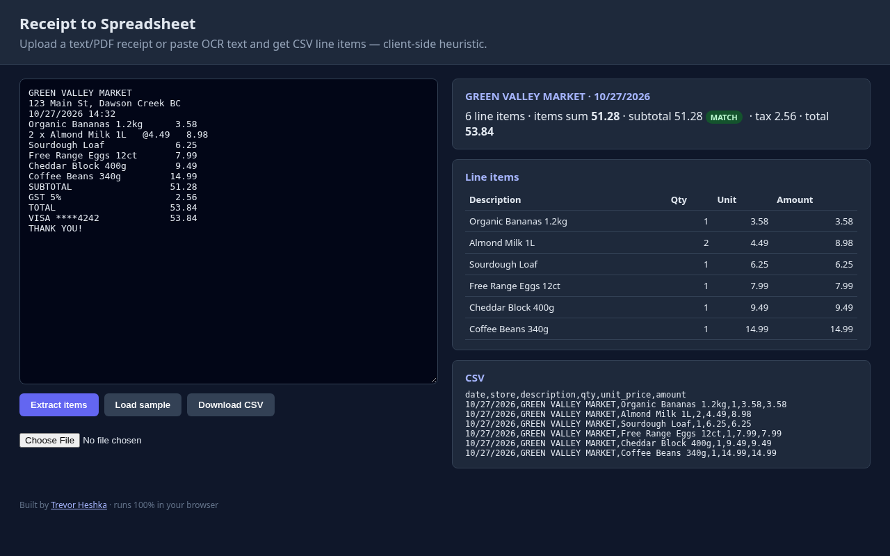

# Receipt to Spreadsheet

Upload a text/PDF receipt or paste OCR text and get CSV line items — client-side heuristic.



## Features
- Parses store, date, line items (qty, unit price, amount), subtotal/tax/total
- Checks items sum against subtotal (MATCH / MISMATCH)
- Download as CSV; text files and simple text-layer PDFs can be uploaded
- **Roadmap:** `extractText()` in `public/app.js` is the plug-in point for a document-vision LLM to handle images/scanned PDFs (not built in yet — paste OCR text for now)

## Dependencies
- **Node.js 16+** (only to serve the static files; the app itself is plain HTML/JS)
- **No npm runtime dependencies**, no API keys, no network calls — everything runs client-side.

## Run
```bash
git clone https://github.com/YardPhantom/receipt-to-spreadsheet.git
cd receipt-to-spreadsheet
npm start            # or: node server.js 8080
# open http://localhost:8080   (add ?demo=1 to auto-load the sample)
```
You can also just open `public/index.html` directly in a browser.

## License
MIT © Trevor Heshka

---
Built by [Trevor Heshka](https://trevorheshka.com)
